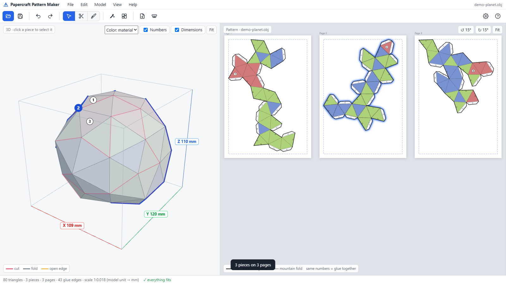

# Papercraft Pattern Maker

Maakt van een low-poly 3D-model (STL, OBJ of GLB) een bouwplaat van papier, met plakstrookjes, randnummers en vouwlijnen. Jij bepaalt waar de stukken geknipt worden.

Werkt helemaal in je browser: niets installeren, geen account, en je modellen verlaten je computer niet. De standaardtaal is Engels; kies **Help → Language → Nederlands** (of Instellingen → Algemeen) voor Nederlands.

> **Bèta:** dit is een bètaversie. Het werkt, maar er zitten waarschijnlijk nog bugs in. [Meld problemen](https://github.com/Jochem77/papercraft-pattern-maker/issues/new/choose) graag; daarmee wordt versie 1.0 degelijk.

[English version → README.md](README.md)

## Starten

Open **`index.html`** in Chrome, Edge, Firefox of Safari. De eerste keer is internet nodig om [three.js](https://threejs.org) (de 3D-weergave) te laden.

## Werkwijze

1. **Openen**: kies een model, of sleep het in het venster. GLB-materialen worden de kleuren in het patroon. Heeft het model meer dan 2.000 driehoeken, dan kun je het eerst vereenvoudigen; de 3D-weergave toont meteen het resultaat.
2. **Automatisch knippen** gebeurt meteen. Het model wordt verdeeld in zo groot mogelijke stukken:
   - elk stuk past op het papier, binnen de marges;
   - er is geen overlap;
   - elk plakstrookje heeft genoeg ruimte.

   Vind je het model lastig te bouwen? Zet dan onder **Instellingen → Automatisch knippen** de optie **Knippen bij scherpe vouwen** aan: scherpe hoeken worden dan een knip met plakstrook in plaats van een vouw. Met **Stukgrootte beperken** worden de stukken kleiner. Met **Maximaal aantal vlakken per stuk** (standaard 8) bepaal je hoeveel vlakken een stuk mag hebben; een plat vlak van meerdere driehoeken telt als één. Bij **Vorm van de stukken** kies je tussen *Groot* (zo min mogelijk stukken), *Compact* (standaard: geen lange armen of rafelige randen) en *Zeer compact*.

   **Effen (foto)karton?** Zet onder **Instellingen → Printen & PDF** de optie **Bedrukte kant is de binnenkant** aan. De nummers en lijnen komen dan aan de binnenkant en de buitenkant blijft schoon. Je print en snijdt nog steeds aan één kant; de stukken liggen gespiegeld op het papier. Kies bij **Snijplotter → Vouwlijnen** dan **Rillen + perforeren**: vouwen die naar de bedrukte kant toe buigen worden geperforeerd (groen in de SVG), de andere gerild (blauw).

   **Niets op de vlakken printen?** Kies onder **Instellingen → Plakstrookjes → Soort** voor *Twee flapjes op elkaar plakken*. Beide stukken krijgen dan langs de naad een flapje met hetzelfde randnummer. Vouw beide flapjes naar binnen en plak ze op elkaar. Zet ook *Nummers alleen op stroken* aan: dan staat er niets op de vlakken en kun je de buitenkant rillen. Bij automatisch uitvouwen worden de stukken zo gemaakt dat beide flapjes passen. Met *Twee flapjes vanaf naadlengte* krijgen korte naden één gewone plakstrook: steviger, en minder dik in smalle delen.
3. Pas het aan met het gereedschap in de werkbalk (beweeg de muis over een pictogram voor de naam):
   - **Selecteren** (S): een stuk aanklikken, verslepen, draaien met Q/E (met Shift 90°).
   - **Knippen** (K): klik bij een rand om te knippen of te verbinden. Shift+klik zet de plakstrook aan de andere kant; Alt+klik knipt ook randen binnen een plat vlak.
   - **Objecten** (O): klik op een los deel van het model en maak het groter of kleiner (in %).
   - **Kleuren** (B): vlakken een andere kleur geven. **Mini-vlakjes herstellen** lost losse foutjes in de kleuren op. Klik op de naam van een kleur om hem te hernoemen; die naam staat op de pagina’s en in de bestandsnaam van de PDF. Per kleur kies je ook het papier (A4 of A3): die kleur krijgt dan eigen pagina’s in die maat, en een eigen PDF.
4. Onder **Instellingen** kies je onder meer:
   - de afmetingen van het model;
   - het opschonen van heel dunne of kleine vlakken in het model (standaard alles dunner dan 2 mm);
   - het papier (A4 of A3) en de marges;
   - de indeling op de pagina’s: *Normaal*, *Zo weinig mogelijk papier* (zoekt een paar seconden naar de indeling met de minste pagina’s) of *Buren bij elkaar* (stukken die aan elkaar vastzitten liggen naast elkaar);
   - de plakstrookjes;
   - het lettertype en de grootte van de nummers;
   - de opties voor de snijplotter.
5. **PDF** downloadt het patroon op ware grootte (1:1). Print op **100% / werkelijke grootte** en meet de controlelijn van 50 mm na.
6. **Snijplotter** geeft een ZIP met één SVG per pagina, in mm. De lagen zijn `print`, `snijden` (gesloten contouren) en `rillen` of `perforeren`.
7. **Opslaan** bewaart het model én al je aanpassingen in één `.papercraft.json`-bestand.

Onder **Help** (F1) staan alle bediening en sneltoetsen.

## Lijnen en nummers in het patroon

| Wat je ziet | Betekenis |
|---|---|
| doorgetrokken lijn | knippen |
| blauwe streepjes | dalvouw (naar je toe) |
| rode streep-punt | bergvouw (van je af) |
| zelfde randnummer | deze randen worden op elkaar geplakt |
| nummer in een rondje | stuknummer (ook zichtbaar in 3D) |
| rood vlak of rode strook | overlap, of een strook zonder ruimte |
| oranje rand | stuk valt buiten het printgebied of over een ander stuk |

## Silhouette Print & Cut

1. Zet **Instellingen → Snijplotter → Registratiemarkeringen (Type 1)** aan.
2. Neem in Silhouette Studio bij **Printen & snijden** dezelfde lengte, lijndikte en inzet over, en zet het paginaformaat op hetzelfde papier. De waarden staan ook onderaan elke PDF-pagina.
3. Print de PDF op 100%.
4. Open in Studio de SVG van dezelfde pagina, laat de rode laag `snijden` snijden, en laat de machine de markeringen lezen.

## Bekende problemen

- De 3D-weergave heeft de eerste keer internet nodig (three.js via een CDN).
- Vooral getest in Chrome en Edge op Windows. Firefox, Safari en touchscreens zijn minder getest.
- Een model met meer dan zo'n 5.000 driehoeken uitvouwen is traag en geeft veel kleine stukjes. Vereenvoudig het (Model → Model vereenvoudigen…) of maak een low-poly versie in een 3D-programma zoals Blender (*Decimate*-modifier) voor het mooiste resultaat.
- Randnummers kunnen elkaar overlappen bij heel scherpe hoeken.
- OBJ-bestanden worden als Y-omhoog gelezen.

## Problemen melden

Een bug gevonden of een idee? Maak een [issue](https://github.com/Jochem77/papercraft-pattern-maker/issues/new/choose) aan.

Vermeld de versie (Help → About) en je browser. Voeg als het kan het model of een opgeslagen project (`.papercraft.json`) toe.

## Ontwikkeling

- `src/core.js`: rekenkern (inlezen, uitvouwen, plakstrookjes, nesting). Werkt ook in Node.
- `src/app.html`: interface.
- `node tools/build.js`: bouwt `index.html`, één los bestand.
- `node tools/browsertest.js pad/naar/model`: headless test in Chrome of Edge.
- `node tools/release.js`: nieuwe versie, changelog, tag en GitHub-release.
- `node --test`: unit-tests van de rekenkern (ook automatisch op GitHub Actions).

## Versies en releasenotes

Het project volgt [Semantic Versioning](https://semver.org). Wat er per versie veranderd is, staat in [CHANGELOG.md](CHANGELOG.md) en op de [Releases-pagina](https://github.com/Jochem77/papercraft-pattern-maker/releases). De versie van het programma zie je onder **Help → About**.

Een nieuwe versie uitbrengen:

1. Beschrijf de wijzigingen onder `## [Unreleased]` in `CHANGELOG.md` en commit ze.
2. Voer `node tools/release.js beta --publish` uit voor de volgende bèta (1.0.0-beta.2), of `node tools/release.js patch|minor|major --publish` voor een definitieve versie.

Het script verplaatst de notities naar een nieuwe versie, verhoogt het versienummer, bouwt `index.html`, commit, maakt de tag `vX.Y.Z`, uploadt, en maakt de GitHub-release met die notities.

## Licentie

Copyright © 2026 Jochem Steenbakkers. Uitgebracht onder de **GNU General Public License v3.0 of later**; zie [LICENSE](LICENSE).
