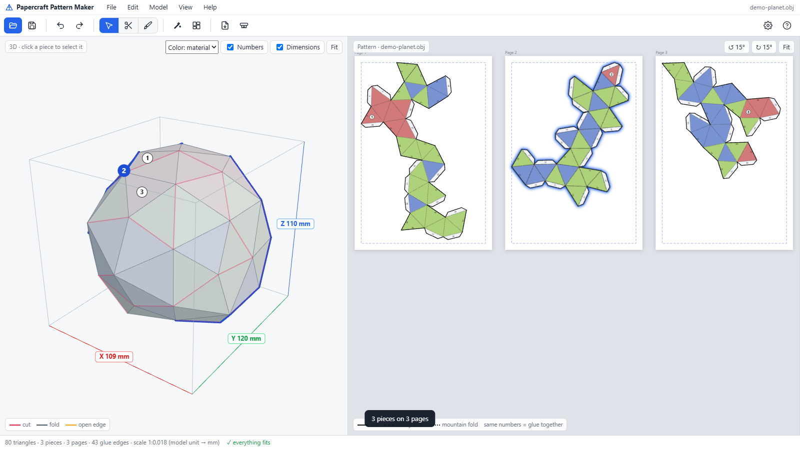

# Papercraft Pattern Maker

Turn a low-poly 3D model (STL, OBJ or GLB) into a printable papercraft pattern with glue tabs, edge numbers and fold lines — and decide yourself where the pieces are cut.

Runs entirely in your browser: no installation, no account, and your models never leave your computer. Available in English and Dutch (Help → Language).

> **Beta:** this is a beta version. It works, but there are probably still bugs. Please [report problems](https://github.com/Jochem77/papercraft-pattern-maker/issues/new/choose); your feedback helps to make version 1.0 solid.

[Nederlandse versie → LEESMIJ.md](LEESMIJ.md)



## Features

- **Import** STL (binary and ASCII), OBJ and GLB. GLB materials and textures become the printed colors.
- **Automatic unfolding** into pieces that are as large as possible:
  - each piece fits on the paper, inside the margins;
  - no piece overlaps itself;
  - every glue tab has enough room, and tabs get narrower or more pointed only where space is tight;
  - tiny leftover pieces are merged into their neighbours.
- **Manual control**:
  - click an edge (in 3D or in the pattern) to cut or join it;
  - Shift+click moves a glue tab to the other side;
  - drag and rotate pieces on the pages;
  - unlimited undo and redo.
- **Colors**:
  - paint faces in a different color or material;
  - fix single-triangle color errors in one click;
  - optionally cut along color borders and group pages per color, for colored paper.
- **Easier to build**: compact pieces without long arms (adjustable), optionally cut at sharp folds (they get a glue tab instead), and limit the size of the pieces.
- **No glue**: tab and flap, hooked together exactly at the seam, instead of glue tabs.
- **Plain card**: put the printed side on the inside (the pieces are mirrored on the paper), and score or perforate each fold depending on its direction.
- **Detailed models**: models with more than 2,000 triangles can be simplified on import, with a live 3D preview. The shape and color borders are kept.
- **Nesting**: pieces are packed tightly, using their real shape and 24 rotations, to save paper.
- **Numbering**: matching numbers on edges that are glued together, plus a piece number in a circle (also shown in 3D).
- **Fold lines**: valley folds as blue dashes, mountain folds as red dash-dot lines.
- **Exports**:
  - **PDF** at true size (1:1). Every page has a 50 mm check line so you can verify the print scale.
  - **SVG for cutting plotters**, one file per page, in mm. Layers: *print*, *cut* (one closed outline per piece) and *score* or *perforate*.
  - **Silhouette Print & Cut**: Type 1 registration marks in the PDF. Their settings are printed on every page, and pieces stay out of the keep-clear zones.
- **Settings**: model size, A4 or A3, margins, tab width and angle, fonts and more.
- **Projects**: save the model together with all your edits in one `.papercraft.json` file.

## Usage

1. Open **`index.html`** in a modern browser (Chrome, Edge, Firefox or Safari). An internet connection is needed once, to load [three.js](https://threejs.org) from a CDN.
2. **Open** a model (File → Open model, or Ctrl+O). A model with more than 2,000 triangles can be simplified first, with a live preview. It is then unfolded automatically.
3. Adjust it with the tools in the toolbar (hover over an icon to see its name):
   - **Select** (S): click a piece to select it, drag to move it, rotate with Q / E.
   - **Cut / join** (K): click near an edge to cut or join it.
   - **Objects** (O): click a separate part of the model and make it larger or smaller (in %).
   - **Paint colors** (B): paint faces. Click a colour's name to rename it; the name is printed on its pages and used in its PDF file name.
4. Choose paper, size and tabs under **Settings** (Ctrl+,).
5. Download the **PDF** (Ctrl+P) and print it at **100% / actual size**, or export the SVG files for your cutting plotter.

The **Help** menu (F1) in the app lists all controls and keyboard shortcuts.

### Silhouette Print & Cut

1. Turn on *Registration marks (Type 1)* under **Settings → Cutting plotter**.
2. In Silhouette Studio, open **Print & Cut** and enter the same length, line thickness and inset. Set the page size to the same paper.
3. Print the PDF at 100%.
4. Open the SVG of the same page in Silhouette Studio, cut the red *cut* layer, and let the machine read the marks.

## Known issues

- The 3D view needs an internet connection the first time, to load three.js from a CDN.
- Mainly tested in Chrome and Edge on Windows. Firefox, Safari and touch devices are less tested.
- Unfolding a model with more than about 5,000 triangles is slow and gives many small pieces. Simplify it (Model → Simplify model…) or make a low-poly version in a 3D program such as Blender (*Decimate* modifier) for the best result.
- Edge numbers can overlap each other at very sharp corners.
- OBJ files are assumed to be Y-up.

## Feedback and bug reports

Found a bug or have an idea? Open an [issue](https://github.com/Jochem77/papercraft-pattern-maker/issues/new/choose).

Please mention the app version (Help → About) and your browser. If you can, attach the model or a saved project (`.papercraft.json`).

## Development

```text
src/core.js          geometry engine: parsers, unfolding, glue tabs, nesting (runs in browser and Node)
src/app.html         user interface (three.js view, pattern view, PDF/SVG export)
tools/build.js       builds index.html: a single self-contained file
tools/browsertest.js headless browser smoke test via the Chrome DevTools Protocol
tools/release.js     version bump, changelog, tag and GitHub release
tests/core.test.js   unit tests (run automatically on GitHub Actions)
```

```sh
node tools/build.js                       # build index.html
node --test                               # unit tests of the geometry engine (generated test models)
node tools/browsertest.js path/to/model   # headless browser test (Chrome or Edge; set CHROME=... if needed)
```

No dependencies or build tools beyond Node.js are needed. three.js is loaded from jsDelivr at runtime.

## Versions and releases

The project follows [Semantic Versioning](https://semver.org). What changed in each version is listed in [CHANGELOG.md](CHANGELOG.md) and on the [Releases page](https://github.com/Jochem77/papercraft-pattern-maker/releases). The version of the app is shown under **Help → About**.

To make a release:

1. Describe your changes under `## [Unreleased]` in `CHANGELOG.md` and commit them.
2. Run `node tools/release.js beta --publish` for the next beta (1.0.0-beta.2), or `node tools/release.js patch|minor|major --publish` for a final release.

The script moves the notes to a new version section, bumps `package.json`, rebuilds `index.html`, commits, tags `vX.Y.Z`, pushes, and creates the GitHub release with those notes.

## License

Copyright © 2026 Jochem Steenbakkers

This program is free software: you can redistribute it and/or modify it under the terms of the GNU General Public License as published by the Free Software Foundation, either version 3 of the License, or (at your option) any later version. See [LICENSE](LICENSE).

three.js is © its authors and is used under the MIT license.
